Product designer in New York. I run [Cinemateca](https://cinemateca.co) and build apps for film, health and privacy.

[santiagoalonso.com](https://santiagoalonso.com) · [Figma](https://www.figma.com/@san) · [Instagram](https://www.instagram.com/madebysan) · [LinkedIn](https://www.linkedin.com/in/madebysan)

<table>
<tr>
<td width="33%" valign="top"> <b>Cinemateca</b> The film research platform <a href="https://cinemateca.co">Visit site</a></td>
<td width="33%" valign="top">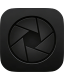 <b>RawCam</b> Shoot unprocessed DNG photos <a href="https://apps.apple.com/us/app/rawcam-raw-dng-camera/id6765531876">App Store</a></td>
<td width="33%" valign="top">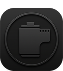 <b>RawLab</b> Film looks, LUTs and emulation In progress</td>
</tr>
<tr>
<td valign="top">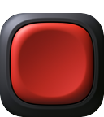 <b>Memo</b> Private voice journal with local AI <a href="https://apps.apple.com/us/app/memo-private-voice-journal/id6794707670">App Store</a></td>
<td valign="top">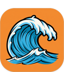 <b>Wave</b> Voice-to-text for any app <a href="https://apps.apple.com/us/app/wave-voice-keyboard/id6759767993">App Store</a></td>
<td valign="top">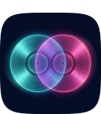 <b>Duet</b> Audio that keeps playing under other apps <a href="https://github.com/madebysan/duet">View repo</a></td>
</tr>
<tr>
<td valign="top">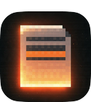 <b>Redact</b> Edit video and audio as text <a href="https://github.com/madebysan/redact">View repo</a></td>
<td valign="top">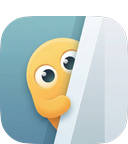 <b>Peek</b> A privacy screen for Mac <a href="https://github.com/madebysan/peek">View repo</a></td>
<td valign="top">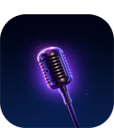 <b>Offscript</b> Auto-paced teleprompter for Mac <a href="https://github.com/madebysan/offscript">View repo</a></td>
</tr>
<tr>
<td valign="top">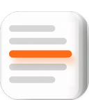 <b>Redraft</b> AI rewrites in any Mac app <a href="https://github.com/madebysan/redraft">View repo</a></td>
<td valign="top">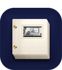 <b>Scriptlook</b> Turn scripts into vision decks <a href="https://www.scriptlook.com">Visit site</a></td>
<td valign="top">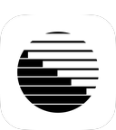 <b>Craft Mockups</b> Create 3D device mockups online <a href="https://craft.santiagoalonso.com">Visit site</a></td>
</tr>
<tr>
<td valign="top">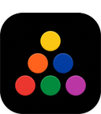 <b>Arrival</b> NYC subway arrivals in a widget <a href="https://apps.apple.com/us/app/arrival-nyc-subway/id6759941751">App Store</a></td>
<td valign="top">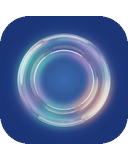 <b>Aura Health</b> Your health data, one dashboard <a href="https://github.com/madebysan/aura-health">View repo</a></td>
<td valign="top">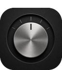 <b>Dial</b> Local radio from around the world <a href="https://github.com/madebysan/dial">View repo</a></td>
</tr>
</table>
