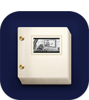
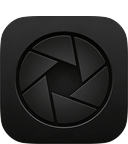
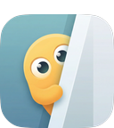
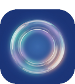
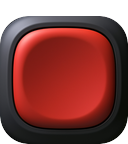
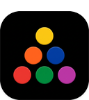
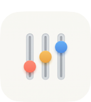

<table>
<tr>
<td width="33%" valign="top"> <b>Cinemateca</b> The film research platform. <a href="https://apps.apple.com/app/id6770142180">App Store</a> · <a href="https://cinemateca.co">Visit site</a></td>
<td width="33%" valign="top"> <b>Redraft</b> Rewrite what's there. Write what isn't. <a href="https://redraft-mac.vercel.app">Visit site</a> · <a href="https://github.com/madebysan/redraft">View repo</a></td>
<td width="33%" valign="top"> <b>Scriptlook</b> Turn a screenplay into a visual deck <a href="https://www.scriptlook.com">Visit site</a></td>
</tr>
<tr>
<td valign="top"> <b>RawCam</b> The iPhone RAW camera for your LUTs. <a href="https://apps.apple.com/us/app/rawcam-raw-dng-camera/id6765531876">App Store</a> · <a href="https://rawcam.santiagoalonso.com">Visit site</a></td>
<td valign="top"> <b>Peek</b> A privacy screen for Mac <a href="https://apps.apple.com/us/app/peek-screen-privacy/id6800797352">App Store</a> · <a href="https://github.com/madebysan/peek">View repo</a></td>
<td valign="top"> <b>Aura Health</b> Your health data in one private dashboard. <a href="https://github.com/madebysan/aura-health">View repo</a></td>
</tr>
<tr>
<td valign="top"> <b>Memo</b> Voice memos and journal entries, processed locally. <a href="https://apps.apple.com/us/app/memo-private-voice-journal/id6794707670">App Store</a></td>
<td valign="top"> <b>Arrival</b> NYC subway arrivals in a widget <a href="https://apps.apple.com/us/app/arrival-nyc-subway-times/id6759941751">App Store</a> · <a href="https://github.com/madebysan/arrival">View repo</a></td>
<td valign="top"> <b>Theme Editor</b> Live theme editor. React + Tailwind v4. <a href="https://github.com/madebysan/theme-editor">View repo</a></td>
</tr>
</table>
